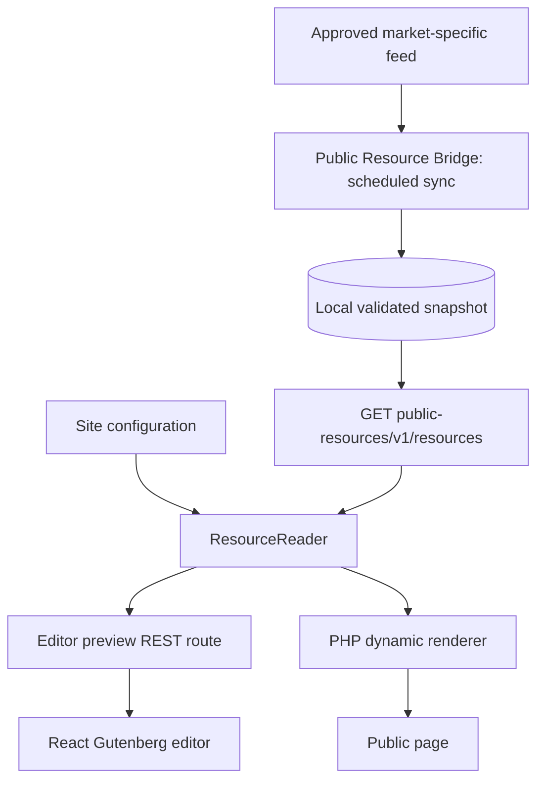

# Approved Resource List

A dynamic Gutenberg block for showing approved public resources in WordPress.

| | |
| --- | --- |
| Scope | Editor controls, resource presentation and local REST consumption |
| Platform | WordPress 6.5+, PHP 8.1+, Gutenberg API v3 |
| Dependencies | Public Resource Bridge v1 contract and WordPress core editor packages |

## Overview

This block provides a reusable way to place approved public resources on patient education and campaign pages. Editors set the heading, heading level, item limit and summary visibility; the block reads normalized resource data from a local REST API.

The integration service handles authentication, approval filtering, synchronization, persistence and expiry. This plugin consumes the existing local read API and does not make upstream requests or perform scheduled synchronization.

Editors cannot change the API endpoint, market or language. Resource payloads are not saved in post content.

## Architecture



| Component | Responsibility |
| --- | --- |
| `SiteContext` | Validates the market, locale and configured source binding. |
| `BlockSettings` | Normalizes saved attributes, limits item counts and constrains heading levels. |
| `ResourceReader` | Dispatches the local REST request, applies the fresh-only policy and validates resource fields. |
| `ResourceBlock` | Registers the block, exposes the preview endpoint and renders escaped semantic HTML. |
| `index.js` | Provides editor controls, preview loading and retry states. |
| `style.css` | Shares theme-aware presentation styles across editor and frontend contexts. |

## Project files

```text
approved-resource-list/
├── approved-resource-list.php
├── block/
│   ├── block.json
│   ├── index.js
│   ├── index.asset.php
│   └── style.css
├── README.md
└── tests/
    ├── smoke.php
    └── smoke-results.txt
```

The JavaScript uses WordPress's bundled React interface and does not require a JSX build step.

## Local setup

Use a disposable local WordPress environment. Install and activate the Public Resource Bridge plugin before this plugin.

Place this directory in `wp-content/plugins/approved-resource-list`.

Example site configuration:

```php
// wp-config.php
define( 'PRB_API_URL', 'https://example.org/prb-feed.json' );
define( 'PRB_API_TOKEN', '' );
define( 'ARL_MARKET', 'CA' );
define( 'ARL_LOCALE', 'en' );
define( 'ARL_SOURCE_URL', 'https://example.org/prb-feed.json' );
```

Use an approved source URL for both source constants. Keep bearer tokens in approved secret management. The `ARL_LOCALE` value uses the bridge's language codes, such as `en` or `fr`, rather than region codes such as `en-CA`.

```bash
wp plugin activate public-resource-bridge
wp plugin activate approved-resource-list
wp public-resources refresh
```

Insert **Approved Resource List** in the editor, then choose a heading and item count.

## API contracts

### Local resource read

```http
GET /wp-json/public-resources/v1/resources?locale=en&page=1&per_page=6
```

This block uses `rest_do_request()` and expects a response from the Public Resource Bridge:

```json
{
  "state": "fresh",
  "fetched_at": "2026-11-24T12:00:00+00:00",
  "items": [
    {
      "id": "example-001",
      "title": "Example public resource",
      "summary": "Example fixture content.",
      "url": "https://example.org/resources/example-001",
      "locale": "en"
    }
  ]
}
```

The block requires `state: fresh`, unique IDs, bounded plain text, HTTPS links without embedded credentials and a matching configured language. Unrecognized fields are discarded.

### Editor preview

```http
GET /wp-json/approved-resource-list/v1/preview?limit=6
```

This route requires `edit_posts`, `edit_pages` or `edit_theme_options`. The only request parameter that affects resource retrieval is the bounded integer `limit`.

| Response | Meaning |
| --- | --- |
| 200, `state: ready` | Resources are available. |
| 200, `state: empty` | The collection has no matching resources. |
| 400 | The limit is invalid. |
| 401/403 | Authentication or capability validation failed. |
| 503, `state: unavailable` | The site binding or integration is invalid, or the snapshot is unavailable or stale. |

Preview responses use `Cache-Control: no-store`. Upstream tokens, raw responses and internal configuration are not returned.

## Implementation notes

### Dynamic rendering

The block stores only its editorial settings. The PHP renderer builds HTML from the current local snapshot, which keeps resources from becoming stale copies in post content. The public page does not require visitor-side JavaScript.

### REST preview

The editor uses the same resource reader as the PHP renderer. Changing the heading or summary visibility does not refetch data; changing the item limit or retrying does. Obsolete requests are cancelled and ignored.

### Fresh-only display

The block displays only fresh resources. Inactive or stale snapshots show an unavailable state. Production deployments should use an approved freshness and withdrawal policy and account for page and CDN caching.

### Editor controls

Market and locale remain deployment settings rather than editor controls. Heading levels are limited to h2–h4. Presentation uses theme preset variables and CSS fallbacks so the block does not impose hard-coded brand colors.

## Verification

```bash
php -l approved-resource-list.php
php -l block/index.asset.php
php -l tests/smoke.php
node --check block/index.js
php tests/smoke.php
```